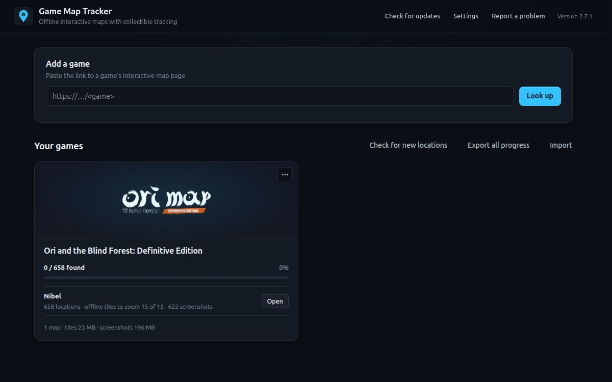
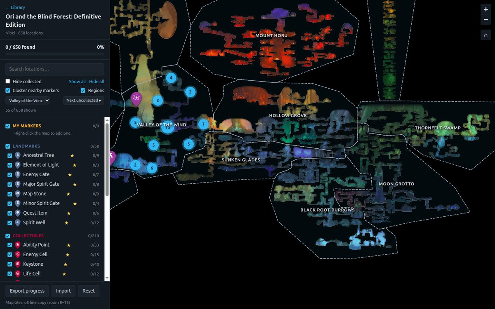
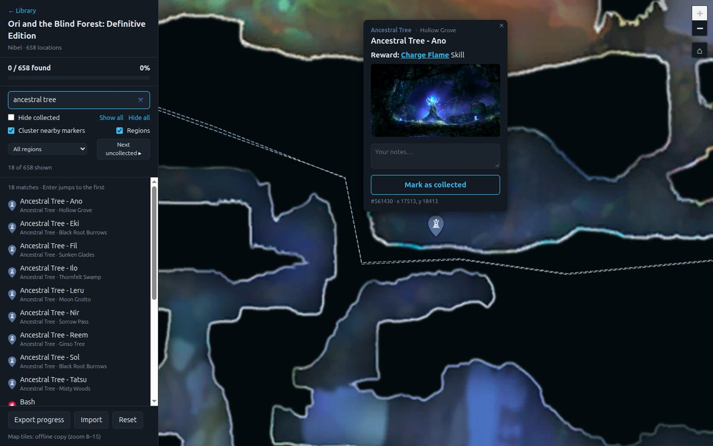

# Game Map Tracker

One standalone desktop app for interactive game maps, built with Electron + Leaflet. Paste the link to a
game's interactive map page and the app keeps a private offline copy of its maps: markers with notes and
screenshots, category filters, and collectible tracking with no account, no premium limit and no internet
connection needed afterwards.

The app downloads map data only when you ask it to, for your personal use. It is not affiliated with any
map site; please respect the terms of the site you use and keep the downloads to what you actually play.





## Download

Prebuilt builds are on the [Releases page](https://github.com/bajicognjen/game-map-tracker/releases):

- **Windows:** `GameMapTracker-Setup-<version>.exe` (installer) or `GameMapTracker-Portable-<version>.exe` (no install).
  The builds are not code-signed, so SmartScreen shows "Windows protected your PC" the first time:
  click *More info → Run anyway*.
- **Linux:** `GameMapTracker-<version>-linux-<arch>.AppImage`. Make it executable (`chmod +x`) and run it;
  on systems without `libfuse2`, run it with `--appimage-extract-and-run`.
- **macOS:** `GameMapTracker-<version>-mac-<arch>.dmg` (arm64 for Apple silicon, x64 for Intel). Unsigned, so
  on first launch right-click the app and choose *Open*.

## Adding games

In the app, open the **Library** (the start screen, or `Ctrl+L`), paste the link to the game's map page
(`https://<site>/<game>` or `https://<site>/<game>/maps/<map>`) and press **Look up**. The app reads the
game's map list and lets you pick which maps to add, whether to download the map tiles for offline use (and
at what detail — each zoom level less is roughly a quarter of the size), and whether to download the
location screenshots. Press **Add game**; progress is shown live and can be cancelled, whatever was
downloaded is kept, and a later **Update** resumes it with the same choices. Maps without any locations are
skipped.

While tiles download, the log shows how much has been fetched and an estimate of what the remaining zoom
levels would add; **Stop tiles at this zoom** keeps what is done and skips the finer levels (the map simply
shows less detail when zoomed in). The library lists each map's tile detail, with an **add detail** link
that downloads the finer levels later.

The same thing from a terminal (needs the source checkout):

```bash
npm run add-game -- https://<site>/<game>
npm run add-game -- https://<site>/<game> --no-media --maps <map> --max-zoom 14
```

Games are stored in the app's user-data folder (`~/.config/game-map-tracker/games/<game>/` on Linux,
`%APPDATA%\game-map-tracker\games\<game>\` on Windows; *Help → Show game data folder* opens it):

```
<game>/game.json                 title, source link and list of maps
<game>/markers/                  marker icon sprite
<game>/maps/<map>/markers.json   locations, categories, groups, regions (flat x/y pixel coordinates)
<game>/maps/<map>/tiles/         {z}/{y}/{x}.jpg, blank.jpg, manifest.json
<game>/maps/<map>/media/         location screenshots
```

A `games/` folder next to the app is scanned too (`--dest bundled`), for games you want to ship inside a
packaged build; add `"games/**"` to `build.files` in `package.json` to include it.

**Settings** (link on the Library screen) lets you move the game data folder, for example to a bigger drive,
and the progress backups folder, for example into a synced folder so another computer with the app restores
the same progress. Each game card shows how much space its tiles and screenshots take, with *delete* links
to free it while keeping the map data and your progress; an *Update* downloads them again. After an Update,
the log says what changed on each map (new, removed and renamed locations).

## Using a map

- **Click** a marker to see its category, region, notes and screenshot.
- **Right-click** a marker, or press the button in its popup, to toggle *collected*.
- Links in notes that point at other locations jump straight to that marker.
- **Search** lists matching locations (title, notes, category, your own notes) in the sidebar; click one, or press Enter, to jump to it.
- Every popup has a **notes** field for your own remarks; notes are searchable.
- **Right-click an empty spot** to add your own marker (title, notes, collected state); they live in the
  "My markers" group at the top of the sidebar.
- **Region outlines** with labels are drawn from the map's region data; untick "Regions" to hide them.
  The region dropdown shows a single region's markers.
- **Next uncollected** (button, or the `N` key) jumps to the nearest marker you have not collected yet,
  within the current filters.
- The **★** next to a category decides whether it counts toward the progress bar, so the bar can track
  just the collectibles you care about.
- Keyboard: `/` focuses search, `N` jumps to the next uncollected marker, `C` collects the marker whose popup
  is open, `Esc` closes it.
- Nearby markers are grouped into **clusters** at lower zooms (green when everything in them is collected);
  click a cluster to zoom in, or untick "Cluster nearby markers" to see every pin.
- Category checkboxes filter the map; group checkboxes toggle a whole group. "Hide collected" hides what you have found.
- Maps of the same game are switched with the dropdown in the sidebar header.
- Progress, notes and your own markers are stored locally per map (IndexedDB via LocalForage), survive
  removing and re-adding a game, and are mirrored to JSON files in the user-data folder after every change
  (*Help → Show progress backups folder*). If the in-app database is ever lost, the backup is restored
  automatically. **Export** / **Import** in the sidebar handle one map; **Export all progress** / **Import**
  on the Library screen handle every game in one file.

## Updates

The installed app checks for a new release on start-up and offers to download it; on Windows (installer)
and Linux (AppImage) it installs itself on restart. The macOS build and the portable Windows build cannot
replace themselves, so they open the download page instead. *Help → Check for updates…* or the link on the
Library screen checks on demand.

## Run from source

```bash
npm install
npm start
```

Requires Node 22+ (Electron 45 needs it). `npm install` also fetches the Electron binary (a postinstall step,
since Electron's package no longer does it itself); if `npm start` ever complains that
`node_modules/electron/dist/electron` is missing, run `node node_modules/electron/install.js`.

## When something goes wrong

Imports write what happened to `app.log` (*Help → Show log folder*), including why a page could not be
read. *Report a problem* on the Library screen opens a prefilled GitHub issue; attach the log to it.

## Tests

```bash
npm run test:e2e
```

Drives the real app with Playwright against a small generated game (`test/fixture.mjs`), with no network:
library, map, popup, collecting, tracked categories, the region filter, "next uncollected", keyboard
shortcuts, notes, a custom marker, region outlines, a custom backups folder, persistence across restarts,
restoring from the backup file and deleting offline tiles. It needs a display;
CI runs it on Linux (under `xvfb-run`), Windows and macOS on every push (`.github/workflows/ci.yml`).

## Layout

```
main.js              Electron main process: window, menu, gamemap:// protocol, IPC
preload.js           bridge exposing a small API to the sandboxed page
index.html           library screen + map screen (sidebar and map canvas)
renderer/app.js      screen switching, remembers the last opened map
renderer/library.js  library screen: list, add (with live progress), update, remove
renderer/mapview.js  Leaflet map, markers, filters, popups, persistence
lib/paths.js         where game data lives (user-data folder, optional bundled games/)
lib/source.js        reads window.mapData from a game's map page with a hidden Electron window
lib/build-markers.js converts the page data into markers.json (tile origin from the map bounds)
lib/tiles.js         tile pyramid downloader that skips blank quadrants; resumable
lib/media.js         screenshot downloader
lib/library.js       list / look up / add / update / remove / clean games; load a map for the renderer
lib/settings.js      settings.json (custom game data and backups folders)
lib/log.js           diagnostics log in the user-data folder
scripts/add-game.js  command-line front end for lib/library.js
test/fixture.mjs     generates an offline game for the end-to-end test
test/e2e.mjs         the end-to-end test
```

## How the coordinates work

The map site serves every map as Web-Mercator tiles inside a tiny lat/lng square near (0, 0). The builder works
out which tiles of the lowest zoom level cover the map (from the declared bounds, widened by any marker outside
them) and projects every marker into flat pixel coordinates of the full-resolution image, with (0, 0) at the
top-left tile corner. The renderer uses a `CRS.Simple` variant whose scale is `2^(zoom − nativeMaxZoom)`, so
Leaflet's zoom levels line up with the tile pyramid.

## Packaging and releases

```bash
npm run build:linux   # dist/GameMapTracker-<version>-linux-<arch>.AppImage (also build:win / build:mac)
```

The build contains only the app; games are added by the user and live in the user-data folder.
The icon comes from `build/icon.png`.

Releases are built by GitHub Actions (`.github/workflows/release.yml`) on Windows, Linux and macOS runners:

1. Bump `version` in `package.json` and commit.
2. Tag and push: `git tag v2.0.2 && git push origin main v2.0.2`.
3. The workflow attaches the installers to a **draft** release named after the tag; publish it from the
   Releases page once you have written the notes.

*Actions → Release → Run workflow* builds without publishing and attaches the installers to the run, which is
useful for testing a change on all platforms.

## License

MIT, see `LICENSE`.
